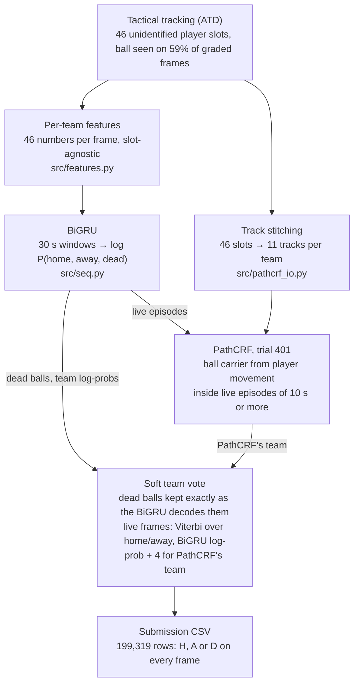

# Ball possession for BAR–ATH — technical document, team Just Some Guys

More than a Hack 2027, Phase 1 · 8 November 2026

## Summary

We label all 199,319 frames of BAR–ATH with two learned models chained together, both trained only on other matches
that have official possession labels. On 7 held-out Bundesliga matches the full pipeline scores spellF1 0.60 /
macroF1 0.89.

- **Dead ball:** a bidirectional GRU (BiGRU) reads 30-second windows of 46 per-frame tracking features and calls every
  frame alive or dead.
- **Team in possession:** PathCRF, a published possession-path model we retrained, reads player movement alone. It
  still works on the 41% of graded frames where the ball is missing.
- **Decoding:** a Viterbi pass with a switch penalty merges the two into whole possessions, because spellF1 scores
  possessions, not frames.

No labels of BAR–ATH, hand-made or otherwise, are used anywhere, and no choice was tuned on the public 5 minutes. As a
sanity check only, the file scores 0.66 / 0.89 there, against 0.33 / 0.62 for the organisers' baseline.

## Approach

The pipeline reads possession from the players rather than from the ball. The given ball is missing on 41% of graded
frames, and the 46 player slots carry no identities. A nearest-player rule, like the organisers' baseline, fails
exactly where the ball is missing.



Dead balls come only from the BiGRU. On live frames PathCRF's team is a strong vote, which a confident BiGRU overrules
on 1.3% of the frames PathCRF covers. `pod/pathcrf_setup.sh` runs these stages in order.

**Design choices, and the evidence for each.** Every choice below was made by leave-one-match-out cross-validation on
7 public Bundesliga (DFL) matches, never on this game.

- **Slot-agnostic features** (`src/features.py`). 46 per-frame numbers: per-team nearest distance to the ball and
  player counts near it, ball visibility and gap length, ball speed and position, team spread and speed, ±0.5 s and
  ±2 s context, seconds since and until each team's last touch, and ball off the pitch. Built per team, not per slot,
  so 46 churning tracklets and 22 clean tracks look alike to the model.
- **A sequence model for dead balls** (`src/seq.py`). A 2-layer bidirectional GRU (hidden size 64) reads 30-second
  windows and outputs log P(home / away / dead) per frame. It beat our first model, a gradient-boosted frame
  classifier on the same features: spellF1 0.467 vs 0.438 on held-out DFL.
- **PathCRF for the team** (`src/pathcrf_run.py`). A published model ([PathCRF, KDD 2026](https://github.com/hyunsungkim-ds/pathcrf))
  that predicts the ball carrier from player movement alone; we take the carrier's team. We retrained it ourselves
  (trial 401). With true dead balls it scores 0.647 on the 7 DFL folds, against 0.474 for the frame classifier.
- **Track stitching** (`src/pathcrf_io.py`). PathCRF needs up to 11 persistent players per team. We join slot
  segments into tracks when a new segment starts within 5 s and at most 8 m/s from where a track ended, then fill gaps
  of up to 2 s.
- **A soft team vote** (`src/seq.py --blend`). On alive frames, a Viterbi pass over home and away scores each team by
  the BiGRU's log-probability plus 4 for the team PathCRF calls. It beat letting PathCRF override outright by +0.014
  spellF1, better on 7 of 7 folds.
- **A switch penalty, not smoothing.** Viterbi charges a fixed cost per change of possession, so one ambiguous frame
  cannot split a possession. The penalty of 3 (log-odds) was picked on DFL folds from 3, 6, 10 and 15.

We focused on the team call because that is where the score is lost. On DFL, perfect dead balls would add 0.026
spellF1 to our pipeline; a perfect team call on alive frames would add 0.315.

## Possession rules

We follow the ground truth's own definition: dead ball comes from the official ball status, and live play belongs to
the team in control until the other team takes control. Most lines are learned from DFL's official labels rather than
hand-written; the decoder's switch penalty sets the rest.

| Situation | What the pipeline does | How it was set |
| --- | --- | --- |
| Ball out of play | `D`, read from the players: walking speeds, spread, set-piece shapes, ball off the pitch | Learned from DFL's official `ballstatus`. DFL freezes a dead ball but BAR–ATH's tracker keeps it moving (median 2.7 m/s), so in training 60% of DFL dead balls are carried by the nearest player and 40% drift |
| Stoppage under 3 s | Takes the label before it | 3 s chosen on DFL folds; 2.7% of DFL stoppages are shorter |
| Restart | `D` ends at the restart touch; the restarting team is not assumed | Learned |
| Loose ball, deflection, aerial duel | Possession stays with the last team in control | No explicit rule: the switch penalty means one contrary touch is not enough |
| Tackle won, interception | Changes team once contrary evidence, mostly PathCRF's carrier call, outweighs the switch penalty | Switch penalty 3, chosen on DFL folds |
| Ball not tracked | PathCRF still calls a carrier from player movement; the BiGRU sees time since each team's last touch | — |
| Live stretch under 10 s | The BiGRU's team alone, since PathCRF needs a 10 s window | — |
| Before kick-off, half-time, after the final whistle | `D` | Halves from the organisers' `games.py`; second-half kick-off at frame 113742, as published in the organisers' FAQ.md. Both are defined once, in `src/possession.play_windows` |

We never write `X` on a graded frame. Because spellF1 fills an abstention with the previous label, `X` would only help
inside a possession, where our decoder already holds the label steady.

## Assets used and dropped

The submission reads one provided asset at inference: the tactical tracking. We tried every other asset and dropped
each one when held-out data showed it did not help.

**Used in the submission**

| Asset | How we use it |
| --- | --- |
| Tactical tracking (ATD), players and ball | The only model input. Per-team features for the BiGRU; slots stitched into 11 tracks per team for PathCRF |
| Tactical tracking, measured noise | Its ball gaps (visible on 59% of graded frames, gaps under 1 s or over 3 s) and player dropout (20.5 of 22 tracked) are copied onto the DFL training data, so we validate on data that looks like this match |
| Frame alignment (`games.py`) | Half boundaries, plus the second-half kick-off frame the organisers publish in FAQ.md; frames outside play are `D` |
| Tactical video and homography | Watched for QA and debugging only, with predicted labels overlaid. Never used to make or correct labels |

**Tried and dropped**

| Asset | What we tried | Why we dropped it |
| --- | --- | --- |
| Broadcast video and tracking | Aligned to tactical frames by reading the scoreboard clock with OCR (±0.5 s), then merged its ball | It has a pitch-coordinate ball on only 26% of graded frames, and adds 2.6% frames the tactical feed lacks |
| Broadcast audio | A referee-whistle detector on the separated crowd audio; a stoppage classifier on local Whisper transcripts of the commentary, trained on SoccerNet-Echoes | The crowd whistles constantly: P(dead \| whistle) is 0.14 against a 0.20 base rate. The commentary classifier reached held-out AUC 0.57 |
| Smart Tagging | `SET PIECES` windows as dead-ball evidence | Only 56% of their frames are dead, and the restart moment cannot be read from them |
| Our own ball detector (tactical video + homography) | YOLOv8n trained on tiles labelled by projecting the tracked ball into the image, no human labels. Raises ball coverage from 59% to about 78% | Simulated on DFL folds it adds at most 0.007 spellF1, inside fold noise, and reproducing it costs a 2.5-hour detector pass. Versions trained on SoccerNet did no better on our feed |

## Training data

Both submitted models are trained on one dataset: 7 public DFL matches with official possession labels. No labelled
data from BAR–ATH is used, by hand or otherwise. The other datasets below were tried, and are listed because they
shaped decisions.

| Dataset | Source and licence | Labelled by | Volume | Used for | In the submission |
| --- | --- | --- | --- | --- | --- |
| DFL / IDSSE open dataset | [floodlight](https://github.com/floodlight-sports/floodlight), CC-BY 4.0 | DFL's official per-frame possession and ball-status codes | 7 Bundesliga matches 2022/23, 25 Hz, about 2.0 M frames after home/away mirroring | Training and leave-one-match-out validation of the BiGRU and PathCRF; every hyperparameter | Yes |
| PFF FC World Cup 2022 | PFF FC public release, free sign-up | Our algorithm, from PFF's human-coded on-ball events (`src/pff.py`); later a teacher model trained on DFL (`src/label_transfer.py`) | 64 matches, resampled to 25 fps | PathCRF training ablations (trials 300, 400); frame-model training | No: the DFL-only PathCRF won both checks, and PFF was neutral for the frame models |
| Metrica Sports sample data | [metrica-sports/sample-data](https://github.com/metrica-sports/sample-data) | Team possession derived by us from Metrica's human-coded events | 2 matches | Held-out sanity check for early models | No |
| PathCRF authors' checkpoint | [hyunsungkim-ds/pathcrf](https://github.com/hyunsungkim-ds/pathcrf) | Trained by the authors on the same DFL data | 1 checkpoint | Reference point for our retraining | No: we submit our own retraining |
| SoccerNet-Echoes and SoccerNet action labels | [SoccerNet](https://github.com/SoccerNet) | Whisper transcripts; SoccerNet's human action labels | 330 matches | Commentary stoppage classifier | No (dropped) |
| SoccerNet Tracking 2023 | [SoccerNet](https://github.com/SoccerNet) | Human-drawn ball boxes | 57 broadcast clips | Ball detector training | No (dropped) |

**Making DFL look like BAR–ATH.** DFL tracking is complete, so in training we degrade it to this match's measured
quality. The ball is hidden in runs drawn from the tactical feed's own gap lengths, 1 to 8 players drop out in
stretches, and the dead ball keeps moving. Home and away are mirrored. A model trained on a milder degradation scored
0.416 on realistically degraded held-out DFL, against 0.438 for one trained realistically, so we use the realistic one.

## Results

On 7 held-out DFL matches, degraded to BAR–ATH's tracking quality, the submitted pipeline scores spellF1 0.602 /
macroF1 0.891. Each stage added to that score, and PathCRF's team call added the most.

| Stage (spellF1, mean of 7 DFL matches, each held out in turn) | spellF1 | Gain |
| --- | --- | --- |
| Frame classifier (gradient boosting) | 0.438 | |
| BiGRU instead of the frame classifier | 0.467 | +0.029 |
| PathCRF team call on live frames | 0.588 | +0.121 |
| Soft team vote (submitted) | 0.602 | +0.014 |

Here PathCRF ran inside DFL's official live episodes. Cutting the episodes from the BiGRU's own dead balls, as on
BAR–ATH, cost 0.001.

| Check | spellF1 | macroF1 | What it is |
| --- | --- | --- | --- |
| DFL, 7 folds, mean | 0.602 | 0.891 | Held out: each match scored by models trained on the other 6. Our yardstick for every decision |
| DFL validation match J03WR9, submitted PathCRF | 0.707 | 0.954 | True dead balls. Optimistic: this match also picked the checkpoint |
| BAR–ATH public 5 minutes | 0.660 | 0.886 | Sanity check only, 17 possessions (organisers' baseline: 0.326 / 0.621) |

**Choosing the PathCRF model.** We trained two final candidates on a rented RTX 4090. Trial 401 (DFL only, 50
epochs) beat trial 400 (DFL plus 63 PFF matches, 15 epochs) on the validation match, 0.707 against 0.683, so we
submitted 401. The public window agreed (0.660 against 0.556), but it was never used to choose.

**How much is left.** The DFL folds put the ceiling for better dead balls at about +0.026 spellF1, and for a perfect
team call at +0.315. PathCRF trained and ran on clean DFL player tracks, so the 0.602 is likely optimistic for this
match's noisier tracks.

Every experiment behind these numbers, including the negative ones, is written up in `eda/NOTES.md`.

## Limitations

Most remaining errors are in the team call around turnovers, not in dead balls. We typed every error on the 7 DFL
folds (`eda/qa.py`) and watched clips of each type.

- **Turnovers with the ball hidden.** In midfield duels PathCRF often switches team 3 to 6 s before or after the real
  turnover. Missed changes (494 cases, 819 s) and wrong-team spells (264 cases, 740 s) are the two largest error
  types. 88% of wrong-team frames are PathCRF's own calls.
- **Short live stretches.** PathCRF needs a 10 s window, so live stretches shorter than that fall back to the BiGRU.
  That is 4% of live frames, called right 70% of the time against 91% where PathCRF runs, and 12% of all wrong-team
  frames.
- **Late stoppages.** On BAR–ATH, dead-ball onsets come about 3 s late, because the tracked ball keeps moving after
  the whistle and only the players' behaviour gives it away. Restarts are within a frame or two.
- **Track identity.** PathCRF expects 11 identified players per team. Our stitched tracks average about 10.8 per
  frame, and identity switches inside a track remain. Training never simulated those switches.
- **League and sample.** Every model is calibrated on Bundesliga matches, and LaLiga tempo differs. The 5 public
  minutes hold 17 possessions, so any number on them carries about ±0.05 of noise.

**With more time we would:**

1. Run PathCRF on short live stretches by padding them to its window.
2. Retrain PathCRF on DFL plus PFF at full length, with PFF labels from our DFL-trained teacher and DFL oversampled 4×
   (trial 402, set up but not adopted).
3. Add a better ball. Our simulation puts a detector that fills half of the hidden frames, with 2% gross errors, at
   +0.02 spellF1.
4. Degrade DFL player tracks to this match's slot and identity quality when training PathCRF.
5. Model stoppages with duration priors (a hidden semi-Markov decoder) and longer context, to cut the late onsets.

## Reproduction

One script regenerates the submitted CSV from a clean clone and the data bundle, on CPU, in about 20 minutes once the
image is built. The BiGRU weights are in the repository. PathCRF's code is fetched at a pinned commit (`1b7c6f8`) and
patched (`pod/pathcrf.patch`), and our trained PathCRF weights download from the repository's release.

The environment is the Docker image in `docker/`: Python 3.11.11, torch 2.5.1 (CPU), numpy 1.26.4, pandas 2.2.3,
scikit-learn 1.5.2, pyarrow 17.0.0 and torch_geometric 2.6.1.

```bash
git clone <public repo URL> mtah && cd mtah
# unpack the data bundle into data/, as in README.md
docker compose up -d --build
docker compose exec -u dev mtah bash -lc 'cd /workspace && bash pod/pathcrf_setup.sh'
python evaluation/validate_submission.py evaluation/results/pathcrf.csv
```

`evaluation/results/pathcrf.csv` is the file we submitted under our team name.

| Step in `pod/pathcrf_setup.sh` | Command | CPU time |
| --- | --- | --- |
| BiGRU dead balls and log-probabilities | `src/seq.py` | about 14 min |
| Stitch tracks, cut live episodes | `src/pathcrf_io.py` | 5 s |
| PathCRF team calls, trial 401 | `src/pathcrf_run.py --trial 401 --alive evaluation/results/seq.csv` | about 2 min |
| Soft team vote, final CSV | `src/seq.py --blend --trial 401` | seconds |

**Retraining** needs the DFL open data (`dfl-cache` in the container downloads 2.4 GB). The BiGRU retrains with
`src/seq.py --train` in about 25 minutes on a laptop. PathCRF trains with `pod/vast.sh` on one RTX 4090; the 7 folds,
the PFF ablation and the final models took about 85 GPU-hours. Every training log is in `pod/logs/`.

## Team

Just Some Guys, four members.

| Member | Main work |
| --- | --- |
| Elijah Cavan | Features, frame and sequence models, PathCRF training, QA and error audit, ball-detector research |
| Brandon Hiles | Docker environment, submission and reproduction, BiGRU and team-vote integration |
| William Ngana | PathCRF retraining on DFL plus PFF (trial 402) |
| Gurashish Bagga | Ball detector trained on SoccerNet |
